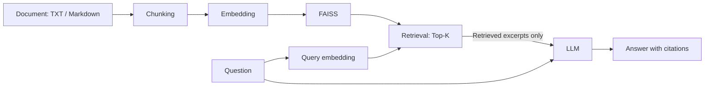

# agri-rag-assistant

Search agricultural documents and ask questions in a Streamlit app that returns
LLM answers with numbered citations and inspectable source excerpts.

## Overview

This portfolio project implements a complete retrieval-augmented generation (RAG)
pipeline: document ingestion, overlapping chunks, embedding generation, persistent
vector search, and evidence-based answer generation. It demonstrates Python application
design, LLM API integration, and offline testing without a RAG orchestration framework.

**Stack:** Python 3.11+ · OpenAI API · FAISS · NumPy · Streamlit · pytest · python-dotenv

**Scope:** a local, single-user prototype for UTF-8 TXT and Markdown files. Included
agricultural documents are original, fictional demo material, not field guidance.
Live answer quality has not been evaluated; automated tests use mocked API responses.

## Features

- Recursively ingest `.txt` and `.md` files, retaining relative source paths and chunk IDs.
- Split text into overlapping chunks and generate embeddings in batches.
- Save and reload a local FAISS index with readable JSON metadata.
- Retrieve Top-K excerpts using cosine similarity and show their scores in the UI.
- Send only retrieved excerpts as evidence to a stateless LLM request.
- Map numbered citations to source filenames and expose the retrieved text for inspection.
- Load credentials from `.env` or the environment; keep secrets and generated files out of Git.
- Test real FAISS search and persistence with deterministic embeddings and mocked SDK clients.

## Architecture

Documents are indexed once. Each question is embedded with the same model and used to
retrieve the closest chunks. The LLM receives the question and those excerpts, with
instructions to cite evidence and acknowledge insufficient information.



| Component | Responsibility |
| --- | --- |
| `src/ingest.py` | UTF-8 loading and character windows: 800 characters, 120 overlap by default |
| `src/retriever.py` | Vector validation, normalization, FAISS search, index and metadata persistence |
| `src/llm.py` | Batched OpenAI embeddings, Responses API adapter, environment loading |
| `src/rag.py` | Evidence assembly, numeric citation validation, cited filename mapping |
| `app.py` | Index build controls, question input, answers, and expandable excerpts |

The default embedding model is `text-embedding-3-small`; the answer model is
`gpt-4o-mini`. Both are configurable through environment variables. The implementation
uses the official OpenAI APIs for
[embeddings](https://developers.openai.com/api/docs/guides/embeddings) and
[text generation](https://developers.openai.com/api/docs/guides/text).

## Quick Start

### Installation

From the project directory, create a virtual environment with Python 3.11 or newer.

**macOS / Linux**

```bash
python3 -m venv .venv
source .venv/bin/activate
python -m pip install -r requirements.txt
cp .env.example .env
```

**Windows PowerShell**

```powershell
py -m venv .venv
.\.venv\Scripts\Activate.ps1
python -m pip install -r requirements.txt
Copy-Item .env.example .env
```

Set `OPENAI_API_KEY` in your local `.env`. Optionally change
`OPENAI_EMBEDDING_MODEL` and `OPENAI_CHAT_MODEL`. Existing environment variables take
precedence over `.env`. API access to the selected models is required.

### Usage

```bash
python -m streamlit run app.py
```

1. Use the supplied `data/sample_documents/` directory or choose another document directory.
2. Click **Build / rebuild index** to embed documents and save `data/index/`.
3. Select Top-K, enter a question, and click **Ask**.
4. Review the answer, cited filenames, and expandable retrieved excerpts.

Rebuild after changing documents, chunk settings, or the embedding model. Selecting a
new directory alone does not replace the saved index. Generated indexes are excluded
from Git and must be built locally after downloading the project.

Building and querying make paid API requests. Document chunks and questions are sent
to OpenAI. Never commit `.env`; `.env.example` contains only an empty key field and model
settings. Load only indexes generated locally by this application.

## Example

**Illustrative walkthrough, not a recorded API run.** The question, retrieved-source
list, and answer below are hand-written to explain the interface using the supplied
sample documents. Actual retrieval order, scores, wording, and citation IDs have not
been measured and may differ. Set Top-K to 1 to try this example.

**Question**

> What should I record before reviewing the irrigation schedule?

**Retrieved sources (illustrative)**

| Citation | Source | Relevant content in the sample file |
| --- | --- | --- |
| [1] | [irrigation.md](data/sample_documents/irrigation.md) | The demo operator records root-zone moisture readings, the observation time, and recent irrigation events before reviewing the schedule. |

**Answer (illustrative)**

> Record root-zone moisture readings, the observation time, and recent irrigation events [1].

The **Cited source files** panel would list `irrigation.md`; the excerpt panel lets the
reader inspect the evidence. The second sample,
[soil_monitoring.txt](data/sample_documents/soil_monitoring.txt), describes sample labels
and observation logs. Neither sample supplies fertilizer application rates.

The prompt requests an answer in the question's language and an acknowledgment when
evidence is insufficient. This is intended behavior, not a guarantee of model accuracy.

## Testing

After installing dependencies, run from the project directory:

```bash
python -m pytest -q
```

The suite contains **36 test cases** and requires no API key or external API calls.
A fixture blocks network connections; deterministic embeddings and mock SDK clients
exercise the pipeline while FAISS operations run locally.

- Retrieval ranking, Top-K limits, persistence, model mismatch, and corrupt metadata.
- Unicode chunk overlap, document loading, invalid inputs, and malformed vectors.
- Retrieved-context isolation, citation mapping, invalid citation IDs, and empty results.
- Embedding batches, stateless generation requests, and sanitized API errors.
- Streamlit initial rendering and blank-question handling through `AppTest`.
- An end-to-end ingestion → saved index → answer path with mocked OpenAI responses.

Verification has been performed on Python 3.12 / Linux. Python 3.11, macOS, Windows,
real API output, and full browser interaction have not been separately verified.

## Project Structure

```text
agri-rag-assistant/
├── README.md
├── requirements.txt
├── .gitignore
├── .env.example
├── pytest.ini
├── app.py
├── src/
│   ├── __init__.py
│   ├── ingest.py
│   ├── retriever.py
│   ├── llm.py
│   └── rag.py
├── tests/
│   ├── conftest.py
│   ├── test_retriever.py
│   └── test_rag.py
└── data/
    └── sample_documents/
        ├── irrigation.md
        └── soil_monitoring.txt
```

`data/index/` is created at runtime and holds `index.faiss` and `metadata.json`.

## Design Decisions

| Decision | Reason and tradeoff |
| --- | --- |
| Small modules and injected dependencies | Keep ingestion, retrieval, and generation independently testable without framework-specific abstractions. |
| Overlapping character windows | Simple bounded chunks support English and Japanese text; sentence boundaries and token counts are not preserved. |
| Normalized vectors with `IndexFlatIP` | Inner product becomes cosine similarity; exact search is easy to inspect but memory and query cost grow with the corpus. |
| FAISS plus JSON metadata | Preserve source attribution without Python pickle; model and record-count checks catch common incompatibilities. Files still require local trust. |
| Stateless generation | Each request uses only the current question and retrieved excerpts, with no tools or conversation history. |
| Numeric citation validation | Reject references to nonexistent excerpts and derive filenames from actual retrieval results; this does not prove a claim is supported. |
| Mock API clients, real FAISS tests | Verify application behavior without credentials, network dependence, or API charges; model quality needs a separate evaluation. |
| Dependency version ranges | Allow compatible updates rather than exact patch pins. NumPy is used directly; pytest is the test dependency. This is not a locked environment. |

## Limitations / Future Work

- **Grounding:** prompts cannot guarantee factual answers or prevent all prompt injection.
  Answers without citations are displayed with a notice; valid citation IDs do not prove
  semantic support. Add claim-level citation checks and evaluate abstention behavior.
- **Retrieval quality:** Top-K always selects the nearest available chunks, even for
  unrelated questions. Add a labeled agricultural QA dataset, retrieval metrics,
  calibrated relevance thresholds, and reranking.
- **Chunking and input size:** character windows can split sentences. Questions have no
  explicit token limit, so very long input may fail at the API. Add token-aware splitting
  and request-budget validation.
- **Storage:** index files are not written transactionally, and source changes are not
  automatically detected. Add corpus fingerprints and atomic index replacement.
- **Deployment:** the app assumes a local, trusted, single-user environment. Authentication,
  per-user storage, concurrency control, and production monitoring are not implemented.
- **Validation:** live model quality and cross-platform installation remain to be checked.
  Add CI across supported Python versions and record a reproducible live demo separately
  from the illustrative example above.
