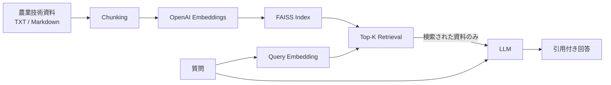

# agri-rag-assistant

農業技術資料を検索し、根拠となる資料を引用しながら回答する
**RAG（Retrieval-Augmented Generation）アプリケーション**です。

Python / OpenAI API / FAISS / Streamlit でRAGパイプラインを実装し、
Dockerコンテナ化したうえで **Amazon ECS / AWS Fargate 上へのデプロイまで実施**しています。

## 概要

本プロジェクトでは、農業技術資料を対象として次の一連の処理を実装しています。

1. TXT / Markdown資料の読み込み
2. 文書のチャンク分割
3. OpenAI Embeddingsによるベクトル化
4. FAISSへの索引登録
5. 質問文のEmbedding
6. 類似資料のTop-K検索
7. 検索した資料だけを根拠としてLLMへ入力
8. 引用付き回答の生成
9. 引用元資料・類似度・検索本文の表示

RAGフレームワークには依存せず、文書読込・検索・LLM呼び出し・引用処理を
小さなPythonモジュールとして実装しています。

さらにDocker化し、Amazon ECRへイメージを登録して
Amazon ECS / AWS Fargate上で実際に動作確認しています。

## 技術スタック

- Python 3.11+
- OpenAI API
- FAISS
- NumPy
- Streamlit
- Docker
- Amazon ECR
- Amazon ECS
- AWS Fargate
- AWS Secrets Manager
- Amazon CloudWatch Logs
- pytest
- python-dotenv

## 主な機能

- `.txt` / `.md` ファイルの再帰的読み込み
- UTF-8日本語資料への対応
- オーバーラップ付きチャンク分割
- OpenAI Embeddingsによるベクトル化
- FAISSによるベクトル検索
- Top-K検索
- コサイン類似度表示
- 検索資料だけを根拠とする回答生成
- `[1]` 形式の引用番号検証
- 引用元ファイル名の表示
- 検索されたチャンク本文の確認
- FAISS索引の保存・再読み込み
- Dockerコンテナ化
- 非rootユーザーでのコンテナ実行
- AWS Secrets ManagerによるAPIキー管理
- ECS / Fargateへのデプロイ
- CloudWatch Logsへの例外出力
- モックAPIを使用したオフラインテスト

## RAGアーキテクチャ



文書登録時にEmbeddingを生成してFAISSへ保存します。

質問時には質問文を同じEmbeddingモデルでベクトル化し、
FAISSから類似する資料断片を取得します。

LLMには質問文と検索された資料断片だけを渡し、
資料に基づいた回答と引用番号の生成を求めます。

## モジュール構成

| ファイル | 役割 |
| --- | --- |
| `src/ingest.py` | UTF-8資料の読み込みとチャンク分割 |
| `src/retriever.py` | FAISS検索、ベクトル正規化、索引保存・読込 |
| `src/llm.py` | OpenAI Embeddings / 回答生成API |
| `src/rag.py` | RAG処理、引用番号検証、引用元ファイル対応 |
| `src/diagnostics.py` | エラー情報の安全な表示 |
| `app.py` | Streamlit UI、索引作成、質問応答 |

デフォルトでは以下を使用します。

```text
Embedding: text-embedding-3-small
Chat model: gpt-4o-mini
```

環境変数で変更できます。

## ローカル環境での実行

### 仮想環境の作成

Linux / macOS:

```bash
python3 -m venv .venv
source .venv/bin/activate
python -m pip install -r requirements.txt
cp .env.example .env
```

Windows PowerShell:

```powershell
py -m venv .venv
.\.venv\Scripts\Activate.ps1
python -m pip install -r requirements.txt
Copy-Item .env.example .env
```

`.env` にOpenAI APIキーを設定します。

```text
OPENAI_API_KEY=your-api-key
```

必要に応じてモデルも変更できます。

```text
OPENAI_EMBEDDING_MODEL=text-embedding-3-small
OPENAI_CHAT_MODEL=gpt-4o-mini
```

### Streamlit起動

```bash
python -m streamlit run app.py
```

ブラウザで表示されたStreamlit画面を開きます。

操作手順：

1. 資料フォルダを指定
2. **「索引を作成・更新」** をクリック
3. Top-Kを選択
4. 質問を入力
5. **「質問する」** をクリック
6. 回答・引用元・類似度・検索本文を確認

資料、チャンク設定、Embeddingモデルを変更した場合は
索引を再作成してください。

## Docker

公式の

```text
python:3.11-slim-bookworm
```

をベースイメージとして使用しています。

### ビルド

```bash
docker build -t agri-rag-assistant:local .
```

### 実行

```bash
docker run --rm --name agri-rag-assistant \
  -p 127.0.0.1:8501:8501 \
  --env-file .env \
  -e APP_ENV=production \
  --mount type=volume,src=agri-rag-index,dst=/app/data/index \
  agri-rag-assistant:local
```

ブラウザで、

```text
http://localhost:8501
```

を開きます。

### コンテナのセキュリティ

コンテナ内では非rootユーザーを使用します。

```text
UID: 10001
GID: 10001
```

Streamlitは、

```text
0.0.0.0:8501
```

で待ち受けます。

APIキーをDockerfileやDockerイメージへ保存しません。

`.env` もDockerイメージにはコピーしません。

## ヘルスチェック

DockerfileではStreamlitのヘルスチェックエンドポイント、

```text
/_stcore/health
```

を利用しています。

確認：

```bash
docker inspect --format '{{.State.Health.Status}}' agri-rag-assistant
```

停止：

```bash
docker stop agri-rag-assistant
```

## FAISS索引

索引は、

```text
data/index/
```

に作成されます。

主な生成ファイル：

```text
data/index/
├── index.faiss
└── metadata.json
```

生成された索引はGit管理対象外です。

Dockerでは、

```text
/app/data/index
```

を書き込み可能なディレクトリとして使用します。

named volumeを利用するとコンテナを再作成しても索引を保持できます。

## AWSデプロイ

本アプリケーションはDocker化したうえで、
**Amazon ECS / AWS Fargate上で実際に動作確認しています。**

AWS構成は次のとおりです。

```text
Browser
   |
   | HTTP :8501
   v
Amazon ECS / AWS Fargate
   |
   +-- Streamlit
   |
   +-- RAG Pipeline
   |     |
   |     +-- Document ingestion
   |     +-- OpenAI Embeddings
   |     +-- FAISS
   |     `-- OpenAI answer generation
   |
   +-- AWS Secrets Manager
   |     `-- OPENAI_API_KEY
   |
   +-- Amazon CloudWatch Logs
   |     `-- Application logs / Traceback
   |
   `-- Amazon ECR
         `-- Docker image
```

## AWSサービスの役割

| AWSサービス | 用途 |
| --- | --- |
| Amazon ECR | Dockerイメージの保存 |
| Amazon ECS | コンテナ管理 |
| AWS Fargate | サーバーレスでのコンテナ実行 |
| AWS Secrets Manager | OpenAI APIキーの安全な保存 |
| Amazon CloudWatch Logs | コンテナログ・Python例外の確認 |

## Amazon ECR

Dockerイメージをビルド後、Amazon ECRへ登録します。

### ECRログイン

```bash
aws ecr get-login-password --region ap-northeast-1 | \
docker login --username AWS --password-stdin \
<ACCOUNT_ID>.dkr.ecr.ap-northeast-1.amazonaws.com
```

### タグ付け

```bash
docker tag agri-rag-assistant:local \
<ACCOUNT_ID>.dkr.ecr.ap-northeast-1.amazonaws.com/agri-rag-assistant:latest
```

### Push

```bash
docker push \
<ACCOUNT_ID>.dkr.ecr.ap-northeast-1.amazonaws.com/agri-rag-assistant:latest
```

READMEではAWSアカウントIDを公開せず、
`<ACCOUNT_ID>` と表記しています。

## AWS Secrets Manager

OpenAI APIキーはAWS Secrets Managerに保存します。

例：

```json
{
  "OPENAI_API_KEY": "your-api-key"
}
```

ECSタスク定義からJSON内の `OPENAI_API_KEY` の値だけを取得し、
コンテナの環境変数として渡します。

```text
AWS Secrets Manager
        |
        v
OPENAI_API_KEY
        |
        v
ECS / Fargate Container
        |
        v
OpenAI API
```

APIキーは以下には保存しません。

- Gitリポジトリ
- Dockerfile
- Dockerイメージ
- Docker build引数

## ECS / Fargate

動作確認した基本構成：

```text
Launch type: Fargate
Container port: 8501
Protocol: TCP
Public IP: enabled
```

FargateタスクからOpenAI APIへのHTTPS通信を許可しています。

ポートフォリオ検証ではFargateタスクのパブリックIPへ直接アクセスして
Streamlitの動作を確認しました。

## AWS上での動作確認

**2026-09-22にAWS ECS / Fargate上で一連のRAG処理を確認しました。**

確認した処理：

```text
Docker build
    |
    v
Amazon ECR
    |
    v
Amazon ECS / AWS Fargate
    |
    +--> AWS Secrets Manager
    |       `--> OPENAI_API_KEY
    |
    +--> OpenAI Embeddings
    |
    +--> FAISS Index
    |
    +--> Top-K Retrieval
    |
    +--> OpenAI Answer Generation
    |
    v
Streamlit
    |
    +--> 回答
    +--> 引用元資料
    `--> 類似度
```

実際に確認した項目：

- Dockerイメージのビルド
- Amazon ECRへのpush
- ECS / Fargateタスク起動
- Streamlit起動
- ポート8501でのHTTPアクセス
- Secrets ManagerからのAPIキー取得
- OpenAI Embeddings APIへのアクセス
- FAISS索引作成
- 日本語農業資料のベクトル検索
- OpenAIによる回答生成
- 引用元資料の表示
- 類似度の表示
- CloudWatch Logsへのログ出力
- Python TracebackのCloudWatchへの出力

これにより、

**Docker → ECR → ECS/Fargate → Secrets Manager → OpenAI API → FAISS → Streamlit**

までのクラウド上の一連の処理を確認しています。

## コシヒカリ出穂予測デモ

公開用サンプルとして、

```text
data/sample_documents/koshihikari_heading_ja.md
```

を収録しています。

この資料では、コシヒカリの出穂予測モデルを題材として、

- 気温
- 日長
- DVR
- DVI
- 出穂閾値
- ベイズ最適化
- 実測出穂日と予測日の比較

について説明しています。

本アプリは資料を検索して説明するRAGであり、
出穂日そのものを数値予測するモデルではありません。

### 質問例

Top-Kを3にして、

> コシヒカリの出穂予測では、気温と日長をどのように利用しますか？

と質問します。

実APIで確認した回答例：

> コシヒカリの出穂予測では、日々の気温と日長を説明変数として生育速度DVRを求めます。DVRは1日あたりの生育の進み具合を表し、DVIは累積された生育ステージの指標として扱われます。設定した起算日の初期DVIに日々のDVRを加算し、DVIが設定した一定の閾値に達するか超える日を予測出穂日として扱います。[1]

引用元：

```text
koshihikari_heading_ja.md
```

実API検証時のTop-K=3：

| 順位 | 資料 | 類似度 |
| ---: | --- | ---: |
| 1 | `koshihikari_heading_ja.md` | 0.623739 |
| 2 | `rice_heading_ja.md` | 0.500960 |
| 3 | `rice_heat_ja.md` | 0.416785 |

生成文や類似度は実行条件によって変化する可能性があります。

詳細：

[docs/koshihikari_demo_verification.md](docs/koshihikari_demo_verification.md)

## エラー処理

本番モードではユーザー画面に詳細なTracebackを表示しません。

アプリケーション例外は、

```python
traceback.print_exc()
```

によってstderrへ出力します。

ECSではこの出力をCloudWatch Logsから確認できます。

これにより、ユーザーへ内部情報を直接表示せず、
運用側では障害原因を確認できます。

## 開発モード

ローカル開発では、

```bash
APP_ENV=development python -m streamlit run app.py
```

として起動できます。

開発モードではStreamlit画面に
サニタイズしたTracebackを表示します。

## RAG診断スクリプト

```bash
python scripts/diagnose_rag.py
```

で実APIを利用した診断を実行できます。

確認項目：

- `.env` 読み込み
- 資料読み込み
- チャンク生成
- Embedding
- NumPy shape / dtype
- FAISS索引作成
- 索引保存
- 索引再読み込み
- 日本語質問検索
- 回答生成
- 引用元確認

成功時には、

```text
data/index/rag_verification.json
```

へ検証結果を保存できます。

## テスト

```bash
python -m pytest -q
```

自動テストでは実OpenAI APIを呼びません。

ネットワーク接続をブロックし、
決定論的EmbeddingとモックSDKクライアントを使用して
RAGパイプラインを検証します。

主なテスト対象：

- Top-K検索
- 検索順位
- FAISS索引保存・読込
- Embeddingモデル不一致
- 壊れたmetadata
- Unicode文書
- チャンクオーバーラップ
- 不正入力
- ベクトルshape検証
- 引用番号検証
- 存在しない引用番号
- 空検索結果
- Embeddingバッチ処理
- LLMリクエスト
- APIエラー処理
- Streamlit初期表示
- 空質問処理
- ingestion → index → retrieval → answer のE2Eテスト

Python 3.12 / Linuxおよび
Python 3.11 Docker環境で検証しています。

さらにPython 3.11コンテナを
AWS ECS / Fargate上で実行確認しています。

## プロジェクト構成

```text
agri-rag-assistant/
├── README.md
├── requirements.txt
├── Dockerfile
├── .dockerignore
├── .gitignore
├── .env.example
├── pytest.ini
├── app.py
│
├── docs/
│   └── koshihikari_demo_verification.md
│
├── scripts/
│   └── diagnose_rag.py
│
├── src/
│   ├── __init__.py
│   ├── diagnostics.py
│   ├── ingest.py
│   ├── retriever.py
│   ├── llm.py
│   └── rag.py
│
├── tests/
│   ├── conftest.py
│   ├── test_koshihikari.py
│   ├── test_diagnostics.py
│   ├── test_japanese.py
│   ├── test_retriever.py
│   └── test_rag.py
│
└── data/
    └── sample_documents/
        ├── irrigation.md
        ├── soil_monitoring.txt
        ├── koshihikari_heading_ja.md
        ├── rice_heading_ja.md
        └── rice_heat_ja.md
```

## 設計上の判断

| 設計 | 理由 |
| --- | --- |
| RAGフレームワークを使わず小さなモジュールに分割 | 各処理を理解・テストしやすくするため |
| オーバーラップ付き文字チャンク | 日本語・英語を単純な方式で処理するため |
| FAISS `IndexFlatIP` | 正規化ベクトルによりコサイン類似度検索を実装するため |
| FAISS + JSON metadata | pickleを使わず引用元情報を保存するため |
| Statelessな回答生成 | 質問ごとに検索結果だけを根拠として渡すため |
| 引用番号検証 | 存在しない検索結果への引用を防ぐため |
| モックAPI + 実FAISSテスト | API料金やネットワークに依存せずテストするため |
| 非root Docker | コンテナの実行権限を限定するため |
| Secrets Manager | APIキーをDocker/Gitから分離するため |
| ECS / Fargate | VMを管理せず同一Dockerイメージをクラウド実行するため |
| CloudWatch Logs | ユーザー画面に内部エラーを出さず運用側で確認するため |

## 制約・今後の改善

### 検索品質

現在は最も近いTop-Kチャンクを必ず取得します。

今後は、

- 農業QA評価データセット
- relevance threshold
- reranking
- retrieval metrics

などを追加できます。

### チャンク分割

現在は文字数ベースです。

文章途中で分割される可能性があるため、
token-aware chunkingやsemantic chunkingへの改善余地があります。

### 永続ストレージ

現在のAWSデモではFAISS索引はコンテナローカルに生成します。

本格運用では、

- Amazon EFS
- S3を利用した索引配布
- 外部Vector DB

などを検討できます。

### 複数タスク

複数コンテナから同時に索引更新する構成には対応していません。

### AWS公開構成

今回のAWS検証では、FargateのパブリックIPとポート8501を利用して
Streamlitへ直接アクセスしています。

これはポートフォリオ動作確認用です。

本番運用では、

- HTTPS
- Application Load Balancer
- 認証
- アクセス制御
- private subnet
- 永続ストレージ
- メトリクス
- アラート

などを追加する必要があります。

## セキュリティ

以下はGitへコミットしません。

```text
.env
OPENAI_API_KEY
AWS credentials
Secrets Manager secret values
```

公開するのは、

```text
.env.example
```

のみです。

APIキーなどの秘密情報がスクリーンショット、ログ、Git履歴などへ
露出した場合は、そのキーを失効して新しいキーへ交換してください。

## ステータス

**AWS ECS / Fargate上でのRAGアプリ動作確認済み（2026-09-22）**

確認済み：

**農業資料 → Embedding → FAISS検索 → LLM回答 → 引用表示**

および、

**Docker → Amazon ECR → Amazon ECS / AWS Fargate → AWS Secrets Manager → CloudWatch Logs**

までを含む、コンテナ化された農業RAGアプリケーションの
エンドツーエンド構成を実装しています。