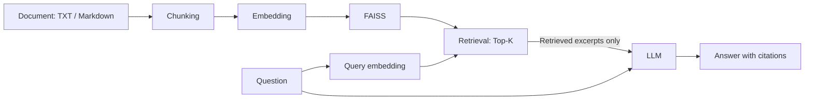

# agri-rag-assistant

Search agricultural documents and ask questions in a Streamlit app that returns
LLM answers with numbered citations and inspectable source excerpts.

## Overview

This portfolio project implements a complete retrieval-augmented generation (RAG)
pipeline: document ingestion, overlapping chunks, embedding generation, persistent
vector search, and evidence-based answer generation. It demonstrates Python application
design, LLM API integration, and offline testing without a RAG orchestration framework.

**Stack:** Python 3.11+ · OpenAI API · FAISS · NumPy · Streamlit · pytest · python-dotenv

**Scope:** a local, single-user prototype for UTF-8 TXT and Markdown files. Included
agricultural documents are original, fictional demo material, not field guidance.
A live Koshihikari demo run is recorded in [the verification report](docs/koshihikari_demo_verification.md);
automated tests use mocked API responses. Broad answer quality has not been evaluated.

## Features

- Recursively ingest `.txt` and `.md` files, retaining relative source paths and chunk IDs.
- Split text into overlapping chunks and generate embeddings in batches.
- Save and reload a local FAISS index with readable JSON metadata.
- Retrieve Top-K excerpts using cosine similarity and show their scores in the UI.
- Send only retrieved excerpts as evidence to a stateless LLM request.
- Map numbered citations to source filenames and expose the retrieved text for inspection.
- Load credentials from `.env` or the environment; keep secrets and generated files out of Git.
- Test real FAISS search and persistence with deterministic embeddings and mocked SDK clients.

## Architecture

Documents are indexed once. Each question is embedded with the same model and used to
retrieve the closest chunks. The LLM receives the question and those excerpts, with
instructions to cite evidence and acknowledge insufficient information.



| Component | Responsibility |
| --- | --- |
| `src/ingest.py` | UTF-8 loading and character windows: 800 characters, 120 overlap by default |
| `src/retriever.py` | Vector validation, normalization, FAISS search, index and metadata persistence |
| `src/llm.py` | Batched OpenAI embeddings, Responses API adapter, environment loading |
| `src/rag.py` | Evidence assembly, numeric citation validation, cited filename mapping |
| `app.py` | Index build controls, question input, answers, and expandable excerpts |

The default embedding model is `text-embedding-3-small`; the answer model is
`gpt-4o-mini`. Both are configurable through environment variables. The implementation
uses the official OpenAI APIs for
[embeddings](https://developers.openai.com/api/docs/guides/embeddings) and
[text generation](https://developers.openai.com/api/docs/guides/text).

## Quick Start

### Installation

From the project directory, create a virtual environment with Python 3.11 or newer.

**macOS / Linux**

```bash
python3 -m venv .venv
source .venv/bin/activate
python -m pip install -r requirements.txt
cp .env.example .env
```

**Windows PowerShell**

```powershell
py -m venv .venv
.\.venv\Scripts\Activate.ps1
python -m pip install -r requirements.txt
Copy-Item .env.example .env
```

Set `OPENAI_API_KEY` in your local `.env`. Optionally change
`OPENAI_EMBEDDING_MODEL` and `OPENAI_CHAT_MODEL`. Existing environment variables take
precedence over `.env`. API access to the selected models is required.

### Usage

```bash
python -m streamlit run app.py
```

1. Use the supplied `data/sample_documents/` directory or choose another document directory.
2. Click **索引を作成・更新** (build / rebuild index) to embed documents and save `data/index/`.
3. Select Top-K, enter a question, and click **質問する** (ask).
4. Review the answer, cited filenames, and expandable retrieved excerpts.

Rebuild after changing documents, chunk settings, or the embedding model. Selecting a
new directory alone does not replace the saved index. Generated indexes are excluded
from Git and must be built locally after downloading the project.

Building and querying make paid API requests. Document chunks and questions are sent
to OpenAI. Never commit `.env`; `.env.example` contains only an empty key field and model
settings. Load only indexes generated locally by this application.

## Dockerでの実行

公式の `python:3.11-slim-bookworm` を使用し、`requirements.txt` から依存関係を
インストールします。既存のローカル起動方法もそのまま利用できます。

```bash
docker build -t agri-rag-assistant:local .
docker run --rm --name agri-rag-assistant \
  -p 127.0.0.1:8501:8501 \
  --env-file .env -e APP_ENV=production \
  --mount type=volume,src=agri-rag-index,dst=/app/data/index \
  agri-rag-assistant:local
```

ブラウザで `http://localhost:8501` を開き、「索引を作成・更新」を押してから質問します。
`--env-file` はホストの設定値を起動時の環境変数として渡す指定で、`.env` 自体は
イメージにもコンテナにもコピー・マウントしません。
Dockerのenv-fileには `OPENAI_API_KEY=値` の形式で記載し、値を引用符で囲まないでください。
既にホストでキーを環境変数に設定している場合は、`--env-file .env` の代わりに
`-e OPENAI_API_KEY` を指定できます。モデル変更時は `OPENAI_EMBEDDING_MODEL` と
`OPENAI_CHAT_MODEL` も起動時の環境変数で渡せます。

コンテナ内では非rootユーザー（UID/GID `10001`）が `0.0.0.0:8501` で待ち受けます。
`/_stcore/health` のHTTPヘルスチェックを設定しています。確認と停止は次のとおりです。

```bash
docker inspect --format '{{.State.Health.Status}}' agri-rag-assistant
docker stop agri-rag-assistant
```

### 索引とイメージの内容

- 公開サンプル5資料を含め、既存の `data/index/` はbuild対象から除外します。
- 索引は起動後の明示的なボタン操作で生成します。起動・buildだけではAPIを呼びません。
- 索引保存先 `/app/data/index` だけをアプリ用の書込可能ディレクトリにしています。
  上のnamed volumeでコンテナ再作成後も索引を保持できます。volume指定を省くと、
  コンテナ削除時に索引も失われます。資料やEmbeddingモデル変更時は再作成してください。
- bind mountや外部ストレージを利用する場合はUID/GID `10001`に書込権限を与えてください。
  単一利用者向けのため、索引を更新するコンテナは1つにしてください。
- `.dockerignore`は許可した実行用ファイルだけをbuildに渡します。
  `.env*`、Git履歴、仮想環境、ホストのキャッシュ、テスト、開発用スクリプト、
  `docs/`の検証記録、生成JSON、FAISS生成物を含めません。
  新しい公開サンプルを同梱する場合は `.dockerignore` の許可リストも更新してください。

### AWSに配置する際の設定

この変更はコンテナ構成の準備までで、AWSへのデプロイは行っていません。
コンテナポートは `8501`、HTTPヘルスチェックパスは `/_stcore/health` です。
APIキーはデプロイ先のシークレット管理から実行時環境変数 `OPENAI_API_KEY` に渡し、
Dockerfileの `ARG` / `ENV` やbuild引数には設定しないでください。
索引用の書込先と、外部OpenAI APIへのHTTPS通信を確保してください。
複数レプリカで共有索引を同時更新する構成は未対応です。
アプリには利用者認証がないため、公開時は認証付きの入口を設け、API利用を制限してください。

### Docker検証結果（2026-09-21）

- ローカルおよびPython 3.11コンテナ内のpytest：各47件成功。
- `docker build`：成功。検証時のイメージは673,412,005 bytes（約642.2 MiB、非圧縮）。
- APIキーなしで起動し、非root実行、healthy、ホスト経由のHTTP 200を確認。
- 実行時にAPIキーを渡したコンテナ内のStreamlit AppTestで、サンプル5資料の
  索引作成・質問応答・引用表示を確認。コシヒカリの気温・日長に関する回答は
  `koshihikari_heading_ja.md` を引用。named volumeから索引を再読込できることも確認。
- イメージ全レイヤーを検査し、実APIキー、`.env*`、ホストの仮想環境・Git・
  キャッシュ・生成済み索引が混入していないことを確認。

依存関係はバージョン範囲指定のため、再build時のサイズは変わる場合があります。
実API検証は単一実行で、回答品質全般やAWS上での動作を保証するものではありません。

構成の参考：[StreamlitのDockerガイド](https://docs.streamlit.io/deploy/tutorials/docker)、
[Dockerのbuild contextと除外設定](https://docs.docker.com/build/concepts/context/)。

## Example

**Illustrative walkthrough, not a recorded API run.** The question, retrieved-source
list, and answer below are hand-written to explain the interface using the supplied
sample documents. Actual retrieval order, scores, wording, and citation IDs have not
been measured and may differ. Set Top-K to 1 to try this example.

**Question**

> What should I record before reviewing the irrigation schedule?

**Retrieved sources (illustrative)**

| Citation | Source | Relevant content in the sample file |
| --- | --- | --- |
| [1] | [irrigation.md](data/sample_documents/irrigation.md) | The demo operator records root-zone moisture readings, the observation time, and recent irrigation events before reviewing the schedule. |

**Answer (illustrative)**

> Record root-zone moisture readings, the observation time, and recent irrigation events [1].

The **参照した資料** (cited source files) panel would list `irrigation.md`; the excerpt panel lets the
reader inspect the evidence. The second sample,
[soil_monitoring.txt](data/sample_documents/soil_monitoring.txt), describes sample labels
and observation logs. Neither sample supplies fertilizer application rates.

The Japanese UI accepts Japanese and English questions. The prompt defaults to Japanese,
while English questions or explicit English requests can receive English answers. When
evidence is insufficient, it requests the exact response `提供された資料からは確認できません`. This is intended behavior, not a guarantee of model accuracy.

### コシヒカリの出穂予測デモ

[公開用サンプル資料](data/sample_documents/koshihikari_heading_ja.md)を追加し、
「コシヒカリ」の出穂予測モデルの設計を質問できるデモにしています。
出穂とは稲の穂が外に現れることです。DVRは「その日の生育の進み具合」、
DVIは「これまでの進み具合の合計」として説明しています。
気温と日長から日々のDVRを求め、DVIに積算して出穂閾値への到達を判定する設計、
ベイズ最適化によるパラメータ探索、実測出穂日と予測日の比較による評価を説明します。
実証済みの研究成果ではなく、未確認の係数・精度・予測日を記載していません。
本アプリは資料を検索して説明するRAGであり、出穂日の数値予測を実装したものではありません。

索引を再作成し、Top-Kを3にして質問してください。

> コシヒカリの出穂予測では、気温と日長をどのように利用しますか？

資料にない具体式やパラメータは推測せず、根拠が不足する質問には
`提供された資料からは確認できません` と答えるよう指示しています。
オフラインテストは資料・引用の受け渡しを検証し、実際の検索順位と回答は
`python scripts/diagnose_rag.py` で確認できます。

**実APIで確認した日本語回答例**

> コシヒカリの出穂予測では、日々の気温と日長を説明変数として生育速度DVRを求めます。DVRは1日あたりの生育の進み具合を表し、DVIは累積された生育ステージの指標として扱われます。設定した起算日の初期DVIに日々のDVRを加算し、DVIが設定した一定の閾値に達するか超える日を予測出穂日として扱います。[1]

引用元は `koshihikari_heading_ja.md` です。Top-K=3の検索結果は以下のとおりです。

|順位|資料|類似度|
|---|---|---|
|1|koshihikari_heading_ja.md|0.623739|
|2|rice_heading_ja.md|0.500960|
|3|rice_heat_ja.md|0.416785|

単一実行の記録であり、順位や回答の再現を保証するものではありません。
検索chunk全文と資料との照合結果は[検証記録](docs/koshihikari_demo_verification.md)を参照してください。

## Testing

### 索引作成の診断

開発時のみ `APP_ENV=development python -m streamlit run app.py` で起動すると、
失敗時に「開発用エラー詳細」で原因例外を含むtracebackを確認できます。
APIキーなどの秘密値は伏せ字にし、ローカル変数は出力しません。
通常起動では詳細を表示しません。`.env` に `APP_ENV=development` を設定することもできます。

`python scripts/diagnose_rag.py` は実APIを使い、`.env`、資料読込・chunk生成、
Embedding、NumPyのshape/dtype、FAISS作成・保存・再読込、指定の日本語質問を順に検証します。
成功時は `data/index/rag_verification.json` に検索chunk全文、スコア、回答、引用元を保存します。
API利用料金が発生します。通信環境や認証設定による失敗は失敗段階とtracebackで確認できます。

After installing dependencies, run from the project directory:

```bash
python -m pytest -q
```

The suite requires no API key or external API calls.
A fixture blocks network connections; deterministic embeddings and mock SDK clients
exercise the pipeline while FAISS operations run locally.

- Retrieval ranking, Top-K limits, persistence, model mismatch, and corrupt metadata.
- Unicode chunk overlap, document loading, invalid inputs, and malformed vectors.
- Retrieved-context isolation, citation mapping, invalid citation IDs, and empty results.
- Embedding batches, stateless generation requests, and sanitized API errors.
- Streamlit initial rendering and blank-question handling through `AppTest`.
- An end-to-end ingestion → saved index → answer path with mocked OpenAI responses.

Verification has been performed on Python 3.12 / Linux and Python 3.11 in Docker.
macOS, Windows, and full browser interaction have not been separately verified.
A single live API demo was verified as documented in the report above.

## Project Structure

```text
agri-rag-assistant/
├── README.md
├── requirements.txt
├── Dockerfile
├── .dockerignore
├── .gitignore
├── .env.example
├── pytest.ini
├── app.py
├── docs/
│   └── koshihikari_demo_verification.md
├── scripts/
│   └── diagnose_rag.py
├── src/
│   ├── __init__.py
│   ├── diagnostics.py
│   ├── ingest.py
│   ├── retriever.py
│   ├── llm.py
│   └── rag.py
├── tests/
│   ├── conftest.py
│   ├── test_koshihikari.py
│   ├── test_diagnostics.py
│   ├── test_japanese.py
│   ├── test_retriever.py
│   └── test_rag.py
└── data/
    └── sample_documents/
        ├── irrigation.md
        ├── soil_monitoring.txt
        ├── koshihikari_heading_ja.md
        ├── rice_heading_ja.md
        └── rice_heat_ja.md
```

`data/index/` is created at runtime and holds `index.faiss` and `metadata.json`.

## Design Decisions

| Decision | Reason and tradeoff |
| --- | --- |
| Small modules and injected dependencies | Keep ingestion, retrieval, and generation independently testable without framework-specific abstractions. |
| Overlapping character windows | Simple bounded chunks support English and Japanese text; sentence boundaries and token counts are not preserved. |
| Normalized vectors with `IndexFlatIP` | Inner product becomes cosine similarity; exact search is easy to inspect but memory and query cost grow with the corpus. |
| FAISS plus JSON metadata | Preserve source attribution without Python pickle; model and record-count checks catch common incompatibilities. Files still require local trust. |
| Stateless generation | Each request uses only the current question and retrieved excerpts, with no tools or conversation history. |
| Numeric citation validation | Reject references to nonexistent excerpts and derive filenames from actual retrieval results; this does not prove a claim is supported. |
| Mock API clients, real FAISS tests | Verify application behavior without credentials, network dependence, or API charges; model quality needs a separate evaluation. |
| Dependency version ranges | Allow compatible updates rather than exact patch pins. NumPy is used directly; pytest is the test dependency. This is not a locked environment. |

## Limitations / Future Work

- **Grounding:** prompts cannot guarantee factual answers or prevent all prompt injection.
  Answers without citations are displayed with a notice; valid citation IDs do not prove
  semantic support. Add claim-level citation checks and evaluate abstention behavior.
- **Retrieval quality:** Top-K always selects the nearest available chunks, even for
  unrelated questions. Add a labeled agricultural QA dataset, retrieval metrics,
  calibrated relevance thresholds, and reranking.
- **Chunking and input size:** character windows can split sentences. Questions have no
  explicit token limit, so very long input may fail at the API. Add token-aware splitting
  and request-budget validation.
- **Storage:** index files are not written transactionally, and source changes are not
  automatically detected. Add corpus fingerprints and atomic index replacement.
- **Deployment:** the app assumes a local, trusted, single-user environment. Authentication,
  per-user storage, concurrency control, and production monitoring are not implemented.
- **Validation:** broader live model quality and cross-platform installation remain to be checked.
  Add CI across supported Python versions and record a reproducible live demo separately
  from the illustrative example above.
